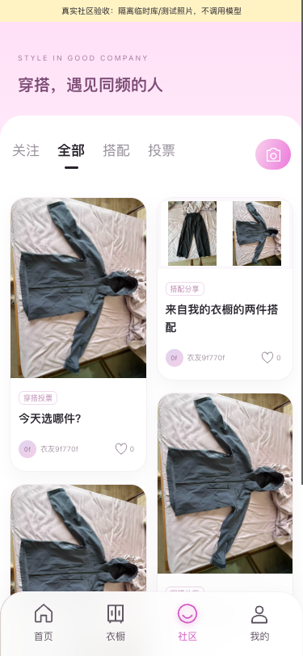
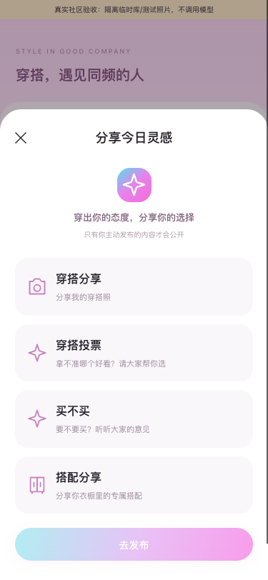
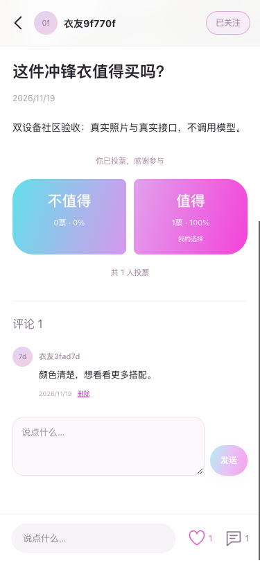

# T20 真实社区验收（2026-11-19）

状态：A→E按人类批准连续实施并逐段验证；最终独立审查与双设备浏览器验收通过。仅合入本地main，不发布GitHub或临时隧道。

## 改了什么

- 底栏为首页 / 衣橱 / 社区 / 我的，原AI搭配移至衣橱顶部子导航，原编排链路保留。
- 社区四栏：关注 / 全部 / 搭配 / 投票。双列图片信息流、独立空态/载入/失败重载、分页、图片失败文字占位。
- 右上角相机打开四类发布：穿搭分享1–9张图、搭配分享2–8件自己的带图单品、穿搭投票2–4个图文选项、“买不买”一图与固定二选项。详情支持关注、点赞、评论、投票、图片切换和本人删帖。
- 八张新增SQLite表（007幂等迁移），Pydantic协议集中models，计数SQL计算，发布/评论防重，唯一投票与选项归属由数据库约束。未更改私人衣柜响应结构。
- 私人衣柜仍按owner隔离。只有主动发布的独立副本可共享，公开作者为独立随机代号。公开响应不返回设备UUID、私有item_id/路径/身材或审计字段。删除私人单品不会撤回已发布副本；删帖与清空全部会撤回。
- 删除公开目录先暂存，SQL失败还原；提交后照片清理失败明确提示，可由原设备重试清理。清空沿用同owner锁和事务，保留当日匿名额度及他人内容。
- 图片校验支持JPEG/PNG/WebP结构检查、10MB/图和30MB/帖限制；图片请求带设备头、nosniff，ObjectURL离开页面即释放。

### 文件范围与分段

| 段 | 代码文件（均在批准范围） | 验证后提交 |
|---|---|---|
| 规则 | AGENTS.md限定社区例外，单独提交；D13随后独立提交 | 4adaec8 / 881ea46 |
| A，4 | app/models.py；app/migrations/007_community.sql；app/tests/test_db.py、test_community_db.py | 6183fdd：357 pytest+50 Vitest，lint |
| B，6 | app/services/community.py；app/routers/community.py；app/main.py；app/routers/wardrobe.py；app/tests/test_community_api.py、test_community_clear.py | 7d3c39c：364 pytest+50 Vitest，lint |
| C，3 | community服务/路由；app/tests/test_community_interactions.py | 9f98816：367 pytest+50 Vitest，lint |
| D，8 | web/src/App.tsx；components/BottomNav.tsx、AppIcon.tsx、CommunityImage.tsx；pages/Community.tsx；lib/communityApi.ts、communityApi.test.ts；styles.css | 5abaddb：367 pytest+56 Vitest，lint/build350ms |
| E，7 | pages/Community.tsx、PostDetail.tsx、PostComposer.tsx、Outfits.tsx；lib/communityApi.ts、communityApi.test.ts；styles.css | 3ea591c：367 pytest+57 Vitest，lint/build364ms |
| 审查修复，4 | community服务、test_community_api、Community页面、PostComposer提示 | 最终373 pytest+57 Vitest，lint/build426ms |

文档另计：README、CHANGELOG、任务板、隐私政策、backlog、设计/计划和本轮报告/截图。原test_db仅按新表扩展精确表与字段集合；旧表字段、外键、幂等断言保留。没有删除/跳过/放宽旧测试、案例或冻结报告。

## 怎么验证的

### 全量命令

仓库根目录，人类终端可复现（使用仓库.venv及本机Node 22）：

```text
zsh -ilc 'make test && make lint && cd web && npm run build'

.venv/bin/python -m pytest -q app/tests
373 passed in 5.09s

Test Files  8 passed (8)
     Tests  57 passed (57)

.venv/bin/python -m ruff check app
All checks passed!
cd web && npx tsc --noEmit

vite v7.3.8 building client environment for production...
✓ 50 modules transformed.
✓ built in 426ms
```

原基线355 pytest+50 Vitest，新增长期回归18后端+7前端；A/B/C/D/E各自全量通过后才继续下一段。单测无网络、固定临时数据库，不向用户真实衣柜写入测试数据。原本运行中的make dev会自动重载并执行幂等迁移；收尾以只读连接核对本地data/app.db已到版本7，八张社区表均为0行，没有把验收帖子灌入真实社区。

### 独立审查与修复

只读审查覆盖whole branch；修复后复审无剩余阻断。以下均先复现失败再修实现：

1. 三种仅文件头/截断图片被当作照片，补结构检查；真实cloth01 JPEG及有效PNG/WebP仍可发布、读取。
2. 相对路径或Mac符号链接数据目录发帖relative_to失败，发布入口规范化路径，新增临时相对目录回归。
3. 浏览器取消发布后前进未恢复弹层：CDP实测`FORWARD failed to reopen publish screen`，修复初始化与popstate后`PASS browser forward restores compose screen`。
4. 新WebP结构解析中发现嵌套ANMF可触发递归放大，1100层约26KB回归先抛RecursionError；改为帧内只允许ALPH/VP8/VP8L，禁止嵌套ANMF。修后API12项通过，真实HTTP也422且中文响应，见[t20-http.json](t20-http.json)。

图片检查是结构完整性校验，不等同于完整像素解码；浏览器解码失败仍显示文字占位。

### 双设备真实浏览器/数据库

使用专属临时目录（`wardrobe-t20-qa-*`）、独立后端18083、两个隔离BrowserContext和不同设备UUID。A临时私人衣柜14件，其中2件带实际cases图片；B初始衣柜0件。公开帖子初始为空，**没有注入成功的社区响应、虚构作者/互动或调用模型**。所有成功发帖与互动均由浏览器调用真实接口并写入真实SQLite。

[t20-browser.json](t20-browser.json)保留23项主检查与6项补验、34张截图尺寸；[t20-database.json](t20-database.json)保留清空后SQL与额度证据。

| 操作 | 实测 |
|---|---|
| A浏览器四类发布 | 穿搭分享2图、搭配分享2件副本、买不买、双图投票，均成功展示详情 |
| 服务端已提交但回包失败 | 捕获实际201后仅将回包注入503；照片File=1、标题与预览保留；原地重试公开帖子总数3→3，无重复 |
| 跨设备可见 | B社区4帖，B私人衣柜仍[]；B读取A私人照片404、删除A帖子404，公开响应不含私有标识 |
| 关注/赞/评论/投票 | B关注A后关注栏4帖；买不买真实计数like=1/comment=1/vote=1；重新打开仍已投票，改投另一选项409；多选项投票也落库 |
| 撤回 | A确认删除自己的帖子，B详情与该帖公开图均404 |
| 清空A | 响应衣柜14件、照片2张；A四业务表及身材表0，A社区作者0，关联帖子/图片/互动清除；B独立1帖/1图保留 |
| 当日额度 | 在临时库预留识别1次（未调用模型），真实DELETE后匿名quota记录逐字段不变，recognition=1；次日过期沿用既有机制 |
| 资源释放 | 切到无图片的“我的”后，A created43/revoked43/active0；B50/50/0 |
| 页面 | 社区四栏loading/error/重载、关注/搭配/投票空态、详情loading/error重载、发布类型/四类表单/失败保留、删帖确认、衣橱AI入口均实际查看 |
| 控制台与布局 | Runtime exception=0；34/34截图innerWidth=375、scrollWidth=375、height=812 |

只有**延迟/503/404失败分支**使用CDP Fetch注入，截图名称及顶部提示明确标注，成功数据始终来自真实API。回包丢失注入发生在真实201之后，不是假发布。真实模型和真实天气调用均为0，临时目录无llm.log。

### 375×812 截图

通过CDP `Emulation.setDeviceMetricsOverride(width=375,height=812,deviceScaleFactor=1,mobile=true)`，不是`--window-size`。主流程21张，补验13张；PNG为375×812。人工查看了全部信息流、类型弹层、照片/搭配/投票编辑及详情、PK投票评论、错误重试和AI入口。代表画面：

| 信息流 | 发布类型 | PK投票与评论 |
|---|---|---|
|  |  |  |

完整文件与尺寸见[t20-browser.json](t20-browser.json)的screenshots；[空态](ui-t20/02-following-empty.png)、[发布失败保留](ui-t20/08-publish-error-retained.png)、[加载](ui-t20/18-feed-loading-injected-delay.png)、[失败重载](ui-t20/19-feed-error-injected.png)、[图片占位](ui-t20/20-photo-error-injected.png)、[衣橱AI入口](ui-t20/28-wardrobe-ai-entry.png)。

### 冻结核对与迁移回退

按`t5d-freeze.json`的sha256逐文件重新计算：

```text
Frozen evidence: 134 / 134 SHA256 unchanged
CDP screenshot dimensions: 34 / 34 at 375x812; scrollWidth=375
```

007只创建社区表/索引，不删旧表列，重复运行幂等测试已覆盖。首次用在自己的库前先停服务备份完整数据目录（含照片），例如仓库根目录：

```bash
cp -Rp data /tmp/wardrobe-before-t20
```

需要回退时停服务，将当前data移开，复制备份后检出旧代码；不要用DROP删除表回退：

```bash
mv data /tmp/wardrobe-after-t20
cp -Rp /tmp/wardrobe-before-t20 data
git checkout 95e866f
```

目录名须选未占用的位置；自定义数据目录应将命令中的data替换为实际目录。上述是新环境首次升级前的备份/回退说明，不代表本轮已创建升级前备份。现有make dev自动重载后本地库已升级为7（只读核对八张社区表均0行）；未向其发布测试内容或执行清空。全部行为验收在临时库，回退真实库必须使用确实存在的升级前备份。

## 遗留与风险

- 社区仍按设备识别，无注册、登录、跨设备同步或身份找回。清除本机存储后可能无法管理旧帖，发布页、README和隐私政策已明确。
- 未新增内容审核/举报、社区配额治理、私信、试穿、商城/积分或推荐算法；长期公开运营前治理另行定范围，已记录backlog。本轮新社区自然为空，等待使用者主动发布。
- 未修改prompt/cases/134冻结证据，未联网调用模型或天气，未接入额外依赖。T9、T14、长期部署与GitHub同步不在本轮。
- 免费测试服务若停止、电脑离线或隧道失效，跨设备访问也会停止；本轮未开启或轮换隧道。
