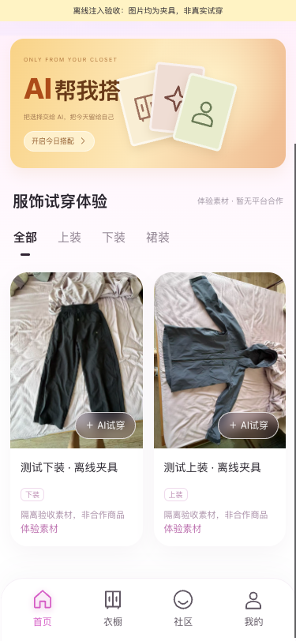

# T21 服饰试穿体验 · 离线验收

日期：2026-11-19。状态：**🟡 离线实现/验收完成；真实试穿未验收**。人类批准A7/B8/C8连续实施，并答复费用“先不做”；本轮没有注册/充值、发送真实人物图或调用FASHN生成。默认生产路径已接真实client，没有USE_MOCK开关。

## 改了什么

首页移除“我的衣橱灵感”个人图墙及上传快捷入口，改成明确标注“体验素材 · 暂无平台合作”的双列服饰目录。保留档案、天气、衣橱数量、AI搭配和底栏；衣橱内导入/上传继续保留，社区不变。体验服饰不进入wardrobe_items、过滤候选或原编排，原P2边界不变。

新增服饰详情、人物照片选择/本地预览与处理说明、提交/准备/排队/处理中/待核/失败/成功状态、原图/结果切换、本人删除。进度只显示0/1或1/1，不虚构百分比；结果仅供外观参考，不承诺尺码或合身。没有真实价格/合作数据，不展示假价格、购物车或购买功能。

体验目录只支持有使用权的本地素材导入，默认dry-run，--apply才复制并入库；没有授权素材时显示空态。缺少服务配置时返回中文提示并保留输入。本轮未向实际目录灌入测试衣物，用户仍需准备素材后才能看到卡片。

### 文件清单（按批准阶段）

| 阶段 | 文件及职责 | 阶段验证 |
|---|---|---|
| 范围例外 | AGENTS.md：限定第三类托管试穿与异步预算，独立提交8029b74；decisions.md：D14，独立提交e4394dc | 不改其他禁用项 |
| A，7代码文件 | app/models.py独立体验协议；migrations/008_tryon.sql三张新表；app/db.py票据/原子保留；test_db.py精确扩展新表；test_tryon_db.py幂等/日界/额度；scripts/import_tryon_catalog.py导入；test_tryon_catalog.py来源/图片/冲突 | 379 pytest+57 Vitest、lint，提交672913c |
| B，8 | app/llm/client.py原生提交/状态查询；.env.example新增占位；services/tryon.py私有任务生命周期；routers/tryon.py目录/任务/图片接口；main.py注册；routers/wardrobe.py清空接线；test_tryon.py、test_tryon_api.py失败注入和持久化 | 392 pytest+57 Vitest、lint，提交270a194 |
| C，8 | pages/Home.tsx目录替换；pages/ProductDetail.tsx试穿交互；components/ExperiencePhoto.tsx私有blob显示/释放；lib/tryonApi.ts自有API；tryonApi.test.ts；tryonView.ts纯状态；tryonView.test.ts；styles.css移动布局 | 392 pytest+64 Vitest、lint/build467ms，提交c2e51c3 |
| 收尾修复，6 | client/service/test_tryon_api：任务日志归因与中文配置文案；ProductDetail/tryonApi/tryonApi.test：新尝试保留票据与轮询恢复 | 最终394 pytest+65 Vitest、lint/build383ms |

文档另计：设计、计划、tasks、CHANGELOG、README、隐私说明及本报告/离线证据。旧test_db只扩展新表/字段精确检查，旧断言不删不跳不放宽。没有新增依赖、包初始化文件、prompt或cases改动。

## 怎么验证的

### 全量命令（最终树）

```text
zsh -ilc 'make test && make lint && cd web && npm run build'

.venv/bin/python -m pytest -q app/tests
394 passed in 3.84s

Test Files  10 passed (10)
     Tests  65 passed (65)

.venv/bin/python -m ruff check app
All checks passed!
cd web && npx tsc --noEmit

vite v7.3.8 building client environment for production...
✓ 54 modules transformed.
✓ built in 383ms
```

完整输出：[t21-validation.txt](t21-validation.txt)。基线373后端+57前端，新增21后端+8前端；每阶段全量通过后才进下一阶段。导入脚本另外执行ruff通过。

### 数据、预算、删除与恢复

- 008新增experience_products/tryon_jobs/tryon_daily_quotas，均为CREATE IF NOT EXISTS，不删旧表列。目录固定owner='catalog'，不是NULL公共衣柜；私有job查询强制owner。原daily_quotas保持五列兼容。
- 原子事务：短期HMAC ticket绑定设备/商品/request_id，15分钟且不过午夜；取得写锁后重验时间与归属日。扣额、匿名请求摘要和job保留同事务。同票同内容返回原job，内容变更409；删除后账本仍命中则410。账本次日0点与计额一起清除，旧ticket过期拒绝。
- 新设备每日3次，分享模式全站10次；并发同票8次保留仅一次，新请求超额429。识别20/编排30原规则不变。清空不重置试穿计额，原owner_lock用于删除/清空与回包落盘复查。
- 提交最多一次POST，不自动重发；每HTTP≤20s、状态最多30次/120s、最短2s。状态查询不会重新生成。提交结果不明确为unknown，恢复时不凭空重提；超时观察结束不等于远端已取消。
- 输入输出通过图片数据直接处理，无公开人物URL；输出仅接受带类型的图片数据并做结构校验，不去抓供应商任意URL。日志不含key/图片/完整请求或原始错误，case_id绑定本地任务。
- 本人删除/清空期间，晚提交/状态回包不会重建照片；跨设备job/结果404。目录及其他设备任务保留。

这些是离线真实SQLite/HTTP与脚本响应测试，不是供应商线上效果测试。

### 独立审查与RED→GREEN

只读whole-branch审查发现2项行为问题，统一修复并回归：

1. 新任务确认回包丢失后，同一弹窗再点会取新票，可能重复生成。浏览器旧版实测：
   `new attempt lost response does not regenerate: false { before: 2, after: 3, modalRemained: true }`。
   修复为每次明确尝试持有一个TryonAttempt，失败复用同票，只有重新进入新任务确认才新建尝试；确认时关闭弹窗，错误与保留输入直接可见。新增Vitest先RED后GREEN；完整浏览器再测：`before=2, after=2`。
2. 轮询遇错后断链，手动查询同status不能恢复。旧版实测：
   `polling resumed after query: false { before: 3, after: 3 }`。
   改为新任务快照驱动单次定时查询，手动查询成功后恢复；完整浏览器：`before=5, after=6`，状态正常继续到完成。

另补自查回归：提交中断恢复unknown、日志等不明确错误不能判为确定失败、用户配置提示不暴露环境变量名、供应商调用绑定本地任务日志上下文；均先RED后GREEN。没有用旧图或规则搭配冒充试穿成功。

### 375×812 浏览器与隔离API

使用独立18084临时后端、两个BrowserContext与不同设备UUID；供应商函数只在隔离验收进程中被替换，生产源码没有开关。**所有输入/结果都是既有服饰夹具，不是真人照片或真实试穿图**；每张截图顶部标注“离线注入验收：图片均为夹具，非真实试穿”。成功状态验证接口与界面接线，不证明模型效果。

CDP设置width375/height812/deviceScaleFactor1/mobile=true，不用--window-size。共23张，均innerWidth375/scrollWidth375/height812，Runtime异常0。

[t21-browser.json](t21-browser.json)：20项主检查及全部截图清单；[t21-database.json](t21-database.json)：清空后临时库计数。

| 场景 | 结果 |
|---|---|
| 首页 | 原个人图墙/上传快捷已移除，空/载入/失败重试/两件夹具卡/分类空态均实际查看 |
| 配置缺失 | 生成提交次数0；照片File/预览保留，中文提示，无key显示 |
| 任务状态 | 真实本地POST202→准备/处理→注入结果；仅0/1或1/1；结果/原图切换，处理中禁重复 |
| 查询故障 | 注入503，手动查询后自动轮询恢复，继续完成 |
| 新任务丢回包 | 供应商注入函数已接收第2次生成后，仅把本地回包改503；原地重试仍2次、不新增生成 |
| 设备隔离 | B读A的job/结果404；B衣柜仍空；B自己的任务独立保存 |
| 删除/清空 | A任务和照片全清，B1任务保留，目录2件保留；匿名额度A2/B1仍保留 |
| 导航与资源 | 衣橱上传入口、社区正常；切到我的后ObjectURL A9/9释放、B7/7释放，active均0 |
| 调用统计 | 注入生成3次；真实供应商生成0次，实际credits/收费未测 |



其他代表截图：[详情](ui-t21/06-product-detail-fixture.png)、[照片选择](ui-t21/07-person-selection-fixture.png)、[未配置保留输入](ui-t21/08-unconfigured-file-retained.png)、[处理中](ui-t21/10-processing-injected.png)、[注入结果非真实试穿](ui-t21/13-result-fixture-not-real.png)、[回包丢失保留](ui-t21/17-new-task-lost-response-retained.png)、[衣橱上传保留](ui-t21/22-wardrobe-upload-preserved.png)。全部23张已通过合成检查图人工查看；最终处理说明文案另补375px照片选择/配置错误截图。

### 冻结、隐私及本机迁移说明

逐文件计算t5d-freeze.json中的SHA256，134/134不变。没有真实人物原图、生成结果、.env、运行库、备份、上传目录或API key进入Git。

实施裁决（Ruling）：原设计给daily_quotas加列会破坏旧测试合法的五列无列名INSERT，故改用独立tryon_daily_quotas；保留旧断言和接口行为，代价为额外一张额度表的维护。仍为A7文件，没有扩大已批准文件范围。

本机原有make dev持续自动重载，早期008草稿曾被自动应用，留下daily_quotas两个额外列。已先用SQLite backup保存到忽略提交的data/backups/t21-pre-reconcile.db，再仅执行最终008的CREATE语句补齐新表；原衣柜/方案/会话/资料/社区/额度行数前后断言一致。禁止删列，所以本机这两个未用列保留；从最终008新建/升级的库不会增加原表列。这个备份是修整前备份，不声称是T21升级前备份；本轮没有重建或清空真实衣柜。

部署/其他本地环境首次升级前，应停服务、备份完整数据目录后启动；需要回退则停服务、恢复确实存在的升级前目录备份并检出旧代码，不能靠DROP或删列回退。新环境备份例：`cp -Rp data /tmp/wardrobe-before-t21`，自定义目录替换data。本次没有对真实库执行该命令，不能用修整前备份冒充升级前备份。

## 遗留与风险

- T21保持🟡：尚无已确认可展示的商品素材，默认目录为空；FASHN账号/key/实际余额和网络、真人效果与耗时/费用均未实测。需要人类准备素材和照片、确认真实调用费用后另行验收。
- 图片为外观生成，不能证明尺码/合身/面料真实性；本轮未验证供应商身份保持、图案保持等效果。
- 暂无平台合作、商品抓取、购物车/购买、价格/分佣；商品平台接入另排。既有衣柜编排/识别模型不改、不新增本地推理或依赖。
- 当日匿名账本不能取消已被远端接收的任务；本地删除不保证供应商记录删除。照片处理说明已写页面与隐私政策。
- 没有同步GitHub、开启隧道或云部署；本轮只合入本地main，真实试穿待资源与预算确认。
