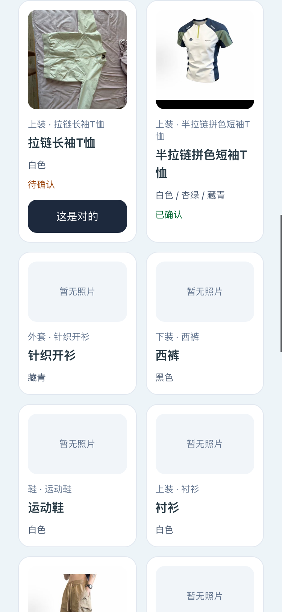
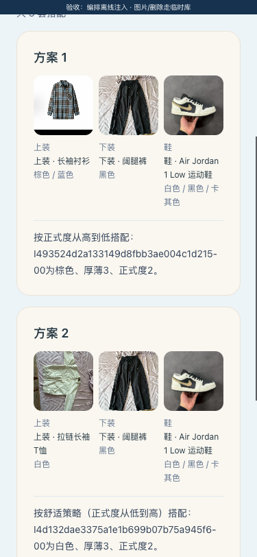

# 算法衣橱 · AI 产品作品说明

面向评审的作品入口，信息截至 **2026-11-14**。本页按“作品信息、作品链接、项目简介、产品设计、验收结果”组织；原始报告和失败记录保留，可从文内链接核对。

## 1. 作品名称、类型与时间

| 项目 | 说明 |
|---|---|
| 作品名称 | 算法衣橱 · Wardrobe Copilot |
| 作品类型 | 个人 AI 产品验证原型；React 移动端网页 + FastAPI 后端，多模态识别与文本编排通过 API 调用 |
| 开发时间 | 2026.11 至今；当前展示版本截至2026-11-14，P0仍在开发，未宣称整体结项或上线 |
| 本人负责 | 需求收敛、产品约束与技术取舍、用例设计、验收复核、失败归因及是否继续投入的裁决 |
| AI 辅助方式 | 使用 Codex 辅助实现代码、测试和文档；通过本机命令、真实 API 记录与浏览器验收复核结果，不把生成代码本身视作交付通过 |

## 2. 作品链接与可见界面

**作品说明入口就是本页，可与仓库或项目附件一起提供。** 当前未提供公开线上地址，完整演示视频尚未录制；README中的localhost地址仅用于本地运行。若招聘系统必须填公网URL，需另行提供本页的公开可访问链接，本轮没有发布或部署。

| 入口 | 读者可以核对什么 |
|---|---|
| [本地启动与项目总览](../README.md) | make dev启动方法、模型配置、当前交付边界 |
| [真实照片上传报告](reports/t5d-upload-chain.md) | 九张照片从浏览器上传、识别、落库到卡片渲染的原文及计时 |
| [真实方案生成与页面验收](tasks.md) / [真实模型调用记录](reports/t6-real-call.md) | 真实模型链路证据，任务板§3.7记录T7接口与页面验收；若只看页面，可打开下方T7截图 |
| [单次评测v2](reports/eval_v2.md) / [重复采样v3](reports/eval_v3.md) | 逐例通过、失败原因、归因、耗时与原始响应 |
| [最新删除与缩略图验收](reports/t15-experience.md) | 删除、失败保留、图片加载/损坏降级与ObjectURL释放 |
| [简历短版与面试口述](05-简历文案.md) | 可直接使用的项目表述与数字来源 |

**真实照片衣柜与逐件确认（T13验收历史界面）：**

**当前方案缩略图界面（T15验收）：**

第二张图中编排响应为验收进程client层离线注入，顶部已标注；图片读取和删除使用临时库真实接口，不能把它当作新增真实模型验收。此前真实模型生成的页面见[T7方案截图](reports/ui-t7/02-ready.png)。[加载中](reports/ui-t15/02-previews-loading.png)、[图片损坏降级](reports/ui-t15/03-previews-image-error.png)、[删除失败保留](reports/ui-t15/06-delete-error-preserved.png)另有截图。

## 3. 面向谁、什么场景、解决什么问题

面向出门前需要从已有衣柜中快速选衣的通勤人群。用户输入衣物照片、当天温度和场合，得到衣柜内可执行的搭配、能核对的属性理由，以及衣物不足时的缺件提示。

灵感图片往往包含用户没有的衣服，手工建档又需要持续填写属性；本项目选择照片识别降低输入负担，再用候选集和代码校验约束模型。项目尚未通过真实用户研究证明节省了多少选衣时间，不引用无原始记录支持的访谈人数、分钟数或留存收益。

## 4. 第一版核心链路与范围取舍

**选择/拖入照片 → 模型识别 → 代码校正并记录来源 → SQLite建档 → 用户确认或编辑 → 输入温度/场合 → 规则筛选 → 模型只从候选ID编排 → 代码终校验 → 方案图片、理由或缺件提示。**

| 设计选择 | 为什么这样做 | 当前实现边界 |
|---|---|---|
| 识别与编排用API，过滤和终校验用代码 | 把属性识别交给模型，把可判定的约束交给确定性逻辑 | 不部署本地视觉权重；两类调用各遵守最多三次尝试预算，超时不重试 |
| 所有上传单品先待确认 | R02曾以0.95置信度错判品类，阈值无法挡住高置信度错误 | 用户确认或修改五字段后才参与推荐；当前含人工确认的完整建档时长未测 |
| 只使用衣柜候选ID，理由引用真实属性 | 输出必须能穿，理由必须能核对 | 数量不足时如实少出；无可组套结果返回缺件卡，不调用模型硬凑 |
| 模型故障走规则模板并显式标记 | 失败仍可提供基础搭配，并告知用户来源变化 | 降级结果仍过同一校验器；照片识别失败保留草稿供重试 |
| 支持编辑、确认、删除与图片失败占位 | 让用户能纠正模型、移除衣物，并在图片不可用时继续理解方案 | 硬删除清历史引用；共用照片只在最后引用删除时清理，不引入软删 |

第一版不做注册登录、多设备同步、3D建模、虚拟试穿、电商导购、社交与付费体系；不引入没有验证依据的体型匹配算法。T9“换一套/不想穿这件”的完整交互原本在计划内，**目前尚未实现**，不能列为已交付。

## 5. 用哪些case验收、重点看什么、结论是什么

用例来自唯一数据源[cases.json](../cases/cases.json)：29条，24条可跑；A01–A05因素材未备显式跳过，不计入24分母。案例评测、单元测试、真实上传与UI故障注入分别计数。

| 代表case或验收项 | 重点检查 | 已有证据与结论 |
|---|---|---|
| R02 / R03识别边界 | 品类和具体款型名是否稳定，是否用一次转绿冒充修复 | v2中R02失败、R03通过；独立重复实验各n=3、均2/3通过。[识别重复性报告](reports/t11-repeatability.md)说明仍有模型能力边界 |
| B02 / B07 / B08温度边界 | 温度区间重叠判定、热天不含外套、凉天应有外套 | 三例在B类N=3采样中均3/3；[逐例报告](reports/eval_v3.md)保留输入对应原文 |
| B03基准表达 | 当前字段能否表达预期的外套排除 | 0/3，归因BENCH；现有规则无法区分该断言要求的外套，保留失败和原expect，不改标准过关 |
| B05 / B10交互依赖 | 排除单品与换一套是否真的完成 | 各0/3，归因T9未实现；基础重复生成不算交互通过 |
| C01 / C02候选不足 | 衣柜不足时是否返回缺件，不从衣柜外补单品 | 通过；纯规则边界。当前API以200+shortage表达衣柜不够，相关接口证据见[任务板T7](tasks.md) |
| C03–C05失败注入 | 解析异常、超时和重复槽位是否进入正确的纠错/降级路径 | 通过；客户端层注入，与C01/C02合计5/5，不计真实模型可靠性或性能数据 |
| T5-D2九张真实浏览器上传 | 上传、识别、来源审计、入库、照片卡片及幂等是否打通 | 9/9接口链路成功；同draft重传不增行、不新增模型调用。5411–8880ms，n=9；不含拍摄、相册选择或后来新增的逐件确认 |
| T13确认与隔离 | 高置信度错标能否被用户确认流程挡住，设备间能否互读 | 初始待确认9/9、确认后解除9/9；双设备隔离/清空已验。属于状态及隔离验收，不是9/9识别正确 |
| T15删除与图片预览 | 跨设备删除拒绝、引用和共用照片清理、图片解码失败降级 | 新增4条后端和5条前端测试；CDP七张375×812无横向溢出。此项有离线编排与故障注入标记，不外推模型质量 |

**可引用的整体结果：**

- 官方单次基线v1/v2各为**20/24（N=1）**，没有整体通过率提升结论；v1/v2原件冻结。
- B类重复采样为**21/30（10例×3次）**：7例每次均通过、3例每次均失败。这只描述该批断言结果，不表示输出一致或线上稳定；不能与20/24相减。
- v3批次生成的**90套最终方案中，衣柜外ID为0**；这是该批样本观测，不是所有场景的保证。组合链路耗时4178–14054ms（n=30、含重试），不冒称HTTP端到端P95。
- 当前main本地回归为**283 pytest + 34 Vitest通过**，make lint通过；命令与证据见[任务板](tasks.md)。单元测试不能替代真实用户“能穿出门”的盲评。

**当前结论：**本地原型已经展示照片建档、人工确认、受约束的真实编排、失败兜底及可追溯评测，能够作为AI产品工具落地作品展示。产品尚未整体验收：人工可穿率、含人工确认的首次建档耗时、HTTP端到端P95仍未测；T9、完整演示视频和T14容器验收仍缺项，公开访问链接也未提供。新增材料只补展示与口径，不宣称这些缺项已完成。
